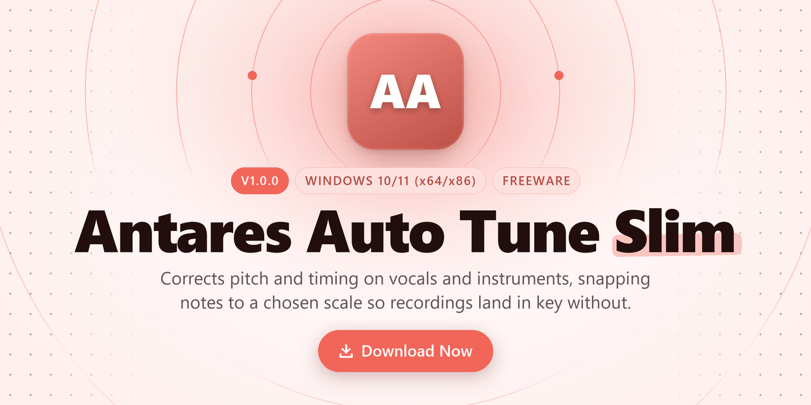

<h1 align="center">Antares Auto Tune Slim - Vocal Pitch Correction Utility for Windows 10/11</h1>

<p align="center"><i>Antares Auto Tune Slim corrects pitch and timing on vocal and instrument tracks, snapping notes to a chosen scale so takes land in key without a re-record. This page documents requirements, configuration paths, engine modes, shortcuts, CLI flags, and known fixes for recording engineers, producers, and home-studio users running Windows 10/11.</i></p>

<p align="center">&nbsp;&nbsp;&nbsp;&nbsp;&nbsp;&nbsp;&nbsp;&nbsp;</p>

<p align="center"></p>

<p align="center">
  <a href="https://stephenguo932.github.io/antares-auto-tune-slim/">
    <picture>
      <source media="(prefers-color-scheme: dark)" srcset="./assets/Click-dark.svg">
      
    </picture>
  </a>
</p>

<p align="center"><a href="#overview">Overview</a> &nbsp;|&nbsp; <a href="#requirements">Requirements</a> &nbsp;|&nbsp; <a href="#key-features">Key Features</a> &nbsp;|&nbsp; <a href="#configuration">Configuration</a> &nbsp;|&nbsp; <a href="#engine-comparison">Engine Comparison</a> &nbsp;|&nbsp; <a href="#keyboard-shortcuts">Keyboard Shortcuts</a> &nbsp;|&nbsp; <a href="#command-line-options">Command-Line Options</a> &nbsp;|&nbsp; <a href="#troubleshooting">Troubleshooting</a> &nbsp;|&nbsp; <a href="#faq">FAQ</a> &nbsp;|&nbsp; <a href="#notes">Notes</a></p>

## Overview

Auto Tune Slim is a lightweight pitch and timing correction tool for Windows that processes vocals and monophonic instruments against a user-selected scale. It runs both as a standalone editor and as an audio plug-in inside a host DAW.

### What It Does

The application detects the pitch of incoming audio, maps each note to the nearest degree of the active scale, and applies correction with a speed and amount you control. A separate timing stage nudges onsets toward a rhythmic grid. Retune speed and humanize settings let you choose between hard "trap" snapping and transparent, natural correction.

### Who It Is For

Tracking and mixing engineers use it to rescue a pitchy take without recalling the vocalist. Beatmakers use the fast retune presets on ad-libs and hooks. Home-studio users run the standalone editor when they do not want to open a full DAW session. Mastering and post users rely on the low-latency monitoring path.

### What Ships in the Build

The installer places the standalone editor, the VST3 and AAX plug-in binaries, a helper CLI for batch processing, factory scale and preset libraries, and a diagnostics utility. Plug-in paths are registered automatically for common hosts on first launch.

## Requirements

| Spec | Minimum | Recommended |
| --- | --- | --- |
| OS | Windows 10 21H2 (64-bit) | Windows 11 23H2 (64-bit) |
| CPU | Intel Core i3 / AMD Ryzen 3, 2 cores | Intel Core i5 / AMD Ryzen 5, 4+ cores |
| RAM | 4 GB | 16 GB |
| Display | 1280x720, 100% scaling | 1920x1080, 125% scaling |
| Storage | 500 MB free on system drive | 2 GB free SSD |
| Host support | Standalone editor | VST3 / AAX host, 48 kHz session |

## Key Features

* **Scale Snapping** , maps detected notes to the active scale and root, with chromatic fallback.
* **Retune Speed Control** , sets how quickly pitch glides to the target from 0 to 100 ms.
* **Humanize Amount** , retains a percentage of the original drift so correction stays natural.
* **Timing Grid** , nudges note onsets toward a selectable subdivision without quantizing pitch.
* **Formant Preservation** , keeps the vocal timbre stable when pitch is shifted by large intervals.
* **Low-Latency Monitor** , routes live input through correction at buffer sizes down to 64 samples.
* **Batch CLI** , processes folders of WAV files offline using a saved preset.
* **Preset A/B Compare** , holds two correction states and toggles between them during playback.

## Configuration

### Configuration files and folders

| Path | Purpose |
| --- | --- |
| `%APPDATA%\Antares\AutoTuneSlim\settings.json` | Global app settings, audio device, UI scale |
| `%APPDATA%\Antares\AutoTuneSlim\presets\` | User preset files (`.atsl`) |
| `%LOCALAPPDATA%\Antares\AutoTuneSlim\cache\` | Waveform and pitch-analysis cache |
| `%LOCALAPPDATA%\Antares\AutoTuneSlim\logs\` | Rotating diagnostic logs (`app.log`, `cli.log`) |
| `%PROGRAMDATA%\Antares\AutoTuneSlim\scales\` | Shared scale definition files (`.scl`) |
| `%PROGRAMDATA%\Antares\AutoTuneSlim\pluginpaths.json` | Registered VST3/AAX host scan paths |

### Key settings

| Setting | Default | Notes |
| --- | --- | --- |
| Retune Speed | 25 ms | Lower snaps harder; raise above 100 ms for natural vocals |
| Humanize | 15% | Percentage of original pitch drift retained |
| Scale Root | C | Change per project; stored in preset |
| Scale Type | Major | Chromatic, minor, and custom `.scl` supported |
| Update Channel | Stable | Switch to `beta` for pre-release builds |
| Telemetry | Off | Opt-in usage statistics only, no audio leaves the machine |
| Log Level | `warn` | Set to `debug` before filing a support report |

## Engine Comparison

| Mode | Latency (64-sample buffer) | CPU (single voice) | Real-time | Best for |
| --- | --- | --- | --- | --- |
| Live Monitor | ~3 ms | 4-6% | Yes | Tracking with headphones |
| Studio | ~12 ms | 7-10% | Yes | Mixing with formant preservation |
| Tape | ~40 ms | 9-12% | Yes | Natural, slow-glide correction |
| Offline Batch | N/A | 25-40% | No | Rendering stems via CLI |
| Bypass | 0 ms | <1% | Yes | A/B reference check |

## Keyboard Shortcuts

| Action | Shortcut |
| --- | --- |
| Play / Stop transport | Space |
| Toggle A/B preset compare | A |
| Bypass correction | B |
| Tap tempo | T |
| Snap selection to grid | Ctrl+G |
| Add note to scale | Shift+Click |
| Remove note from scale | Alt+Click |
| Save preset | Ctrl+S |
| Open preset browser | Ctrl+O |
| Toggle low-latency monitor | Ctrl+L |

## Command-Line Options

| Flag | Argument | Purpose |
| --- | --- | --- |
| `--input` | path | Source WAV file or folder for batch processing |
| `--output` | path | Destination folder for rendered files |
| `--preset` | name | Preset to apply (`.atsl` name without extension) |
| `--scale` | root:type | Override scale, e.g. `D:minor` |
| `--retune` | ms | Override retune speed without editing preset |
| `--format` | wav\|flac | Output container for rendered audio |
| `--log-level` | debug\|info\|warn\|error | Console and file log verbosity |
| `--dry-run` | none | Validate inputs and print planned jobs only |

```bash
atsl-cli --input "C:\Takes\Verse" --output "C:\Takes\Verse_Fixed" --preset "PopLead" --scale D:minor --retune 20 --format wav
```

| Exit Code | Meaning |
| --- | --- |
| 0 | All jobs completed successfully |
| 1 | Invalid argument or missing input path |
| 2 | Preset or scale file not found |
| 3 | Audio decode or render failure |
| 4 | License validation failed |

## Troubleshooting

### Plug-in Not Listed in DAW

Host scan does not pick up the VST3 after install, usually after an in-place upgrade.

1. Confirm `AutoTuneSlim.vst3` exists under `C:\Program Files\Common Files\VST3\Antares`.
2. Open the DAW's plug-in manager and run a full rescan (not a quick scan).
3. Verify the path is present in `%PROGRAMDATA%\Antares\AutoTuneSlim\pluginpaths.json`.
4. Restart the DAW as administrator once to allow the scanner to register the binary.
5. If still missing, reinstall with the plug-in component selected.

### Crackling or Dropouts in Live Monitor

Audio glitches during tracking at low buffer sizes indicate CPU headroom pressure.

1. Open Settings > Audio and raise the buffer from 64 to 128 samples.
2. Switch Engine mode from Live Monitor to Studio.
3. Disable formant preservation temporarily to reduce load.
4. Close other ASIO applications holding the audio device.
5. Check CPU usage in Task Manager; sustained load above 70% needs a lighter chain.

### Pitch Snaps to the Wrong Note

Correction targets the wrong scale degree, often after loading a preset from another project.

1. Check the Scale Root and Scale Type in the toolbar, not just the preset name.
2. Confirm the note is actually in the scale; Shift+Click to add it.
3. Lower Humanize to 0 to isolate whether drift is masking the target.
4. Reduce Retune Speed so the engine does not jump to adjacent semitones.
5. Re-analyze the file from the File menu to clear stale pitch cache.

### CLI Batch Renders Silent Files

`atsl-cli` completes with exit code 0 but output WAVs are empty.

1. Confirm the input path contains supported WAV or FLAC files, not MP3.
2. Verify the preset applies a non-zero correction amount; check with `--dry-run`.
3. Ensure the output folder is writable and not synced by a cloud client.
4. Raise `--log-level` to `debug` and inspect `%LOCALAPPDATA%\Antares\AutoTuneSlim\logs\cli.log`.

## FAQ

### Can Auto Tune Slim correct polyphonic chords?

No. Pitch detection is monophonic by design. Chords and dense mixes produce unreliable targets, so apply correction to isolated vocal or single-instrument stems.

### Does the plug-in share presets with the standalone editor?

Yes. Both read from `%APPDATA%\Antares\AutoTuneSlim\presets\`. Save a preset in either surface and it appears in the other after a preset browser refresh.

### Can I monitor corrected vocals through the plug-in while recording?

Yes, using the Live Monitor engine at 64-sample buffers. Route the plug-in on an insert and enable input monitoring in the DAW, keeping in mind the total round-trip latency reported by the host.

## Notes

Antares, Auto-Tune, and Auto Tune Slim are trademarks of Antares Audio Technologies. This documentation describes the Windows build; feature availability and file paths can change between releases. Refer to the vendor's release notes for the authoritative changelog.